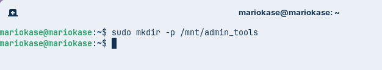

# NF1.UD4

## Fase 1: Preparació de l'entorn

**SERVER:**


**CLIENT:**


**PINGS PER REVISAR CONNEXIÓ:**


## Fase 2: Preparació del servidor amb SSH
 
Ens connectem per SSH al servidor:


Creem els grups devs i admins

```bash
sudo groupadd devs
sudo groupadd admins
```


Creem el usuari dev01 al grup devs

```bash
sudo useradd -m -g devs dev01
```


Creem l'usuari admin01 al grup admins

```bash
sudo useradd -m -g admins admin01
```


Creem els directoris /srv/nfs/dev_projects i /srv/nfs/admin_tools

```bash
sudo mkdir -p /srv/nfs/dev_projects /srv/nfs/admin_tools
``` 


Configurem els permisos dels grups de devs i admins que els dos han de ser root i que els devs tinguin el control sobre els projectes i a els admins a les eines.

Propietari root i grup devs per a projectes de desenvolupament:

```bash
sudo chown root:devs /srv/nfs/dev_projects
```


Propietari root i grup admins per a eines d'administració:

```bash
sudo chown root:admins /srv/nfs/admin_tools
```


Utilitzem la comanda chmod per configurar els permisos de cada prup i per els directoris per configurar el control total

De devs:

```bash
sudo chmod 770 /srv/nfs/dev_projects
```


De Admins:

```bash
sudo chmod 770 /srv/nfs/admin_tools
```


Instal·lem els paquets necesaris per el servei NFS

```bash
sudo apt update
sudo apt install nfs-kernel-server -y
```


Configurem les exportacions que haurem d'editar l'arxiu /etc/exports

```bash
 sudo nano /etc/exports
```

Posem el següent al final de l'arxiu per configurar les exportacions
```text
/srv/nfs/dev_projects  10.0.2.4/24(rw,sync,no_subtree_check,insecure)
/srv/nfs/admin_tools   10.0.2.4/24(rw,sync,no_subtree_check,insecure)
```


Fem les comprovacions per saber si estan ben configurades 

El primer es reiniciar el servei NSF

```bash
sudo systemctl restart nfs-kernel-server
```

Fem la comporvació

```bash
sudo showmount -e
```

El resultat hauria de ser:

```text
Export list for localhost:
/srv/nfs/admin_tools  10.0.2.4/24
/srv/nfs/dev_projects 10.0.2.4/24
```


---

### Fase 3: L'Exportació d'Administració (El Dilema del root_squash)

El client necessita que el directori /srv/nfs/admin_tools sigui accessible per l'equip d'administradors. A vegades, l'usuari root del client (que sou vosaltres, els consultors) necessitarà escriure en aquest directori per instal·lar eines. Aquí mostrarem un error típic i la seva solució.

#### Prova 1 (L'error comú)

1. Exportar el directori `/srv/nfs/admin_tools` amb les opcions 'rw,sync'.


```bash
sudo exportfs -ra
sudo exportfs -v
```


```bash
sudo nano /etc/exports
```

2. Des del client, muntar aquest recurs compartit a `/mnt/admin_tools`. Com a root del client, intentar crear un fitxer dins d'aquest directori muntat.




3. Verificar quin és el propietari del fitxer creat. Per què? Justificar la resposta amb l'explicació tècnica de 'root_squash'.


#### Prova 2 (La Solució)

1. Modificar l'exportació del directori `/srv/nfs/admin_tools` per incloure l'opció 'no_root_squash'.

2. Al client, desmuntar i tornar a muntar el recurs compartit.

3. Com a root del client, intentar crear un fitxer dins d'aquest directori muntat. Observeu quin és el propietari del fitxer creat aquesta vegada. Ha canviat alguna cosa? Justificar la resposta amb l'explicació tècnica de 'no_root_squash'.

### Fase 4: L'Exportació de Desenvolupament (Permisos rw vs ro)

1. Editar /etc/exports per afegir dues exportacions per al mateix directori. El client vol que la xarxa d'administració (p.ex., 192.168.56.0/24) hi pugui escriure, però que la xarxa de consultors (simularem que és una altra IP, p.ex., 192.168.56.150) només pugui llegir.

   > Si les dues màquines es veuen per xarxa NAT, useu una IP consistent amb el rang de la xarxa NAT. Per exemple, per exemple, 10.0.2.100.

2. Des del client, muntar el recurs compartit a `/mnt/dev_projects` i provar d'escriure-hi com a usuari dev01. Hauria de funcionar.

3. Desmuntar el recurs i canviar manualment la IP del client a 192.168.56.100. Tornar a provar d'escriure al directori muntat com a usuari dev01 i comprovar que només funciona la lectura.

4. Canvieu d'usuari al client a admin01 i torneu a provar d'escriure al directori muntat. Comproveu que no es pot escriure, ja que admin01 no és membre del grup devs (permisos locals del sistema de fitxers).

### Fase 5: Muntatge Automàtic amb /etc/fstab

És evident que els usuaris no poden estar muntant manualment els recursos compartits cada vegada que reinicien el sistema. Per això, es configurarà el muntatge automàtic mitjançant el fitxer /etc/fstab al client.

1. Editar el fitxer /etc/fstab al client per afegir les entrades necessàries per muntar automàticament els recursos compartits NFS al directori `/mnt/admin_tools` i `/mnt/dev_projects` durant l'inici del sistema.

2. Executar la comanda `mount -a` per provar les entrades sense reiniciar.

3. Reiniciar el client i verificar que els recursos compartits s'han muntat correctament.
