# NF1.UD4


## Preparació del servidor amb SSH
 

Creem els grups devs i admins

```bash
sudo groupadd devs
sudo groupadd admins
```

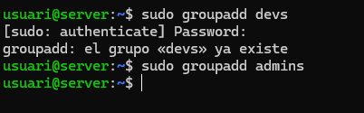

Creem el usuari dev01 al grup devs

```bash
sudo useradd -m -g devs dev01
```

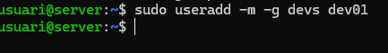

Creem l'usuari admin01 al grup admins

```bash
sudo useradd -m -g admins admin01
```

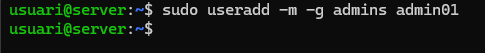

Creem els directoris /srv/nfs/dev_projects i /srv/nfs/admin_tools

```bash
sudo mkdir -p /srv/nfs/dev_projects /srv/nfs/admin_tools
``` 

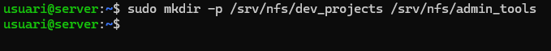

Configurem els permisos dels grups de devs i admins que els dos han de ser root i que els devs tinguin el control sobre els projectes i a els admins a les eines.

Propietari root i grup devs per a projectes de desenvolupament:

```bash
sudo chown root:devs /srv/nfs/dev_projects
```

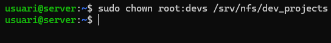

Propietari root i grup admins per a eines d'administració:

```bash
sudo chown root:admins /srv/nfs/admin_tools
```

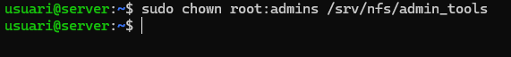

Utilitzem la comanda chmod per configurar els permisos de cada prup i per els directoris per configurar el control total

De devs:

```bash
sudo chmod 770 /srv/nfs/dev_projects
```

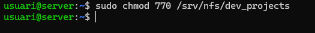

De Admins:

```bash
sudo chmod 770 /srv/nfs/admin_tools
```

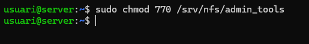

Instal·lem els paquets necesaris per el servei NFS

```bash
sudo apt update
sudo apt install nfs-kernel-server -y
```

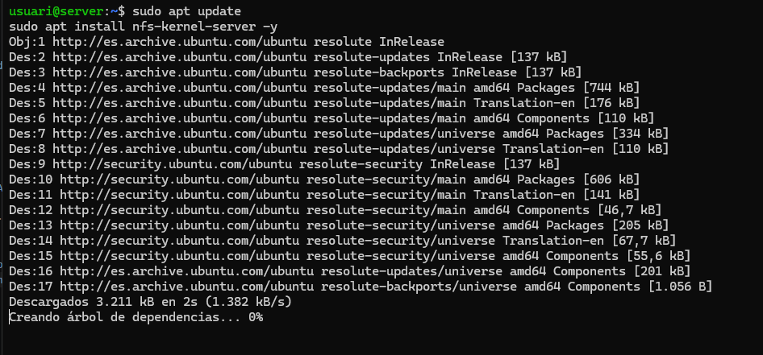

Configurem les exportacions que haurem d'editar l'arxiu /etc/exports

```bash
 sudo nano /etc/exports
```

Posem el següent al final de l'arxiu per configurar les exportacions
```text
/srv/nfs/dev_projects  10.0.2.0/24(rw,sync,no_subtree_check,insecure)
/srv/nfs/admin_tools   10.0.2.0/24(rw,sync,no_subtree_check,insecure)
```

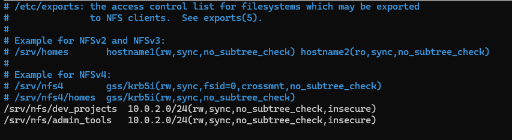

Fem les comprovacions per saber si estan ben configurades 

El primer es reiniciar el servei NSF

```bash
sudo systemctl restart nfs-kernel-server
```

Fem la comporvació

```bash
sudo showmount -e
```

El resultat hauria de ser:

```text
Export list for localhost:
/srv/nfs/admin_tools  10.0.2.0/24
/srv/nfs/dev_projects 10.0.2.0/24
```

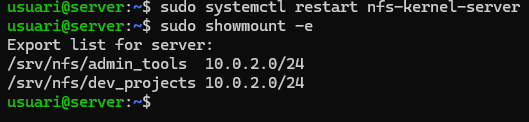

---

nou